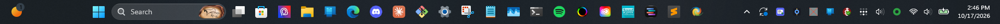
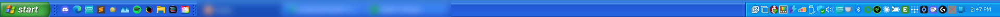
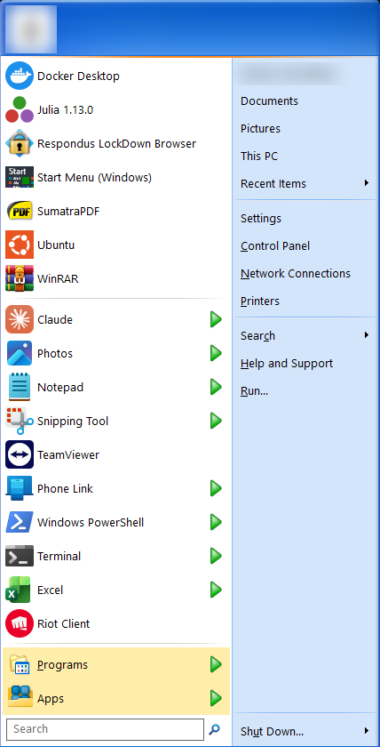

<p align="center">
  
</p>

# EraSwitch

[](https://github.com/Londopy/EraSwitch/actions/workflows/ci.yml)
[](https://github.com/Londopy/EraSwitch/releases/latest)
[](https://github.com/Londopy/EraSwitch/releases)
[](CHANGELOG.md)
[](LICENSE)
[](https://www.rust-lang.org)
[](#install)

**Windows XP on the outside, Windows 11 underneath, one click apart.**

EraSwitch is a tray app that switches your desktop to a Windows XP look (the green **start**
button, the Luna Start menu, the blue taskbar) and back to stock Windows 11 with one click or
one hotkey. Your PC keeps working exactly the same: same apps, same updates, same everything.
Only the shell changes.

## What it looks like

**Windows 11, as usual:**



**One click on the tray icon later:** RetroBar's XP taskbar with the green start button
(XP Blue theme shown; Olive Green, Silver and others are a dropdown away)...



**...and the two-column Luna Start menu, from Open-Shell:**

<p align="center">
  
</p>

Click the tray icon again and it's the first picture again. (Window titles and the account
name are blurred in these shots.)

<!-- demo.gif goes here once it's recorded:
<p align="center">
  
</p>
-->

## Features

- **One click both ways.** Left-click the tray icon, or press **Ctrl+Alt+E**. Exiting
  EraSwitch switches you back to Windows 11 first.
- **Puts things back from a record, not a guess.** Before it changes anything, EraSwitch
  writes down what Windows 11 looked like (taskbar and its auto-hide setting, Start menu
  settings, wallpaper, sounds) and restores from that. One limit: it saves your wallpaper as a
  picture, so a Spotlight or slideshow background comes back as a still image.
- **Hard to get stuck in.** That record lives on disk. A crash, Ctrl+C or an uninstall puts
  Windows 11 back; if EraSwitch is killed outright, start it again and switch back, or run
  `EraSwitch.exe --restore`. With "start when I sign in" on, a reboot in XP mode comes back
  in XP mode.
- **The pieces are yours to pick.** Taskbar (any of RetroBar's XP themes: Blue, Olive Green,
  Silver, Royale...), Start menu (Open-Shell's XP Luna skin), wallpaper and sound scheme, each
  on or off.
- **Eras are files.** Save your setup as a `.londo` file (wallpaper included) and share it.
- **No admin rights.** Everything EraSwitch changes is per-user. (Installing RetroBar or
  Open-Shell the first time may ask for admin rights; that's their installers.)

## Install

Every [release](https://github.com/Londopy/EraSwitch/releases/latest) has the same set of
downloads; pick whichever you like.

| Download | What it is |
|---|---|
| `eraswitch-<version>-setup-x64.exe` | **Installer (recommended).** Per-user, no admin prompt. |
| `eraswitch-<version>-x64.msi` (also `x86`, `arm64`) | MSI installer. Per-user by default; IT can deploy it machine-wide. |
| `EraSwitch-v<version>-x64-portable.exe` (also `x86`, `arm64`) | One exe, nothing to install. |
| `EraSwitch-v<version>-portable.zip` | All three builds in one zip; settings stay next to the exe. |
| `install.ps1` / `install.cmd` | Script install that picks the right build and checks its SHA-256. |
| `EraSwitch-v<version>.torrent` / magnet link | Everything above over BitTorrent; downloads straight from GitHub even with no seeders. |

**PowerShell one-liner:**

```powershell
irm https://github.com/Londopy/EraSwitch/releases/latest/download/install.ps1 | iex
```

Options: `-Msi`, `-Portable`, `-AllUsers`, `-Version 1.2.3`. To pass them, run the script as
a block: `& ([scriptblock]::Create((irm https://github.com/Londopy/EraSwitch/releases/latest/download/install.ps1))) -Portable`

**Scoop:**

```powershell
scoop bucket add londopy https://github.com/Londopy/scoop-bucket
scoop install londopy/eraswitch
```

**MSI for every user** (admin): `msiexec /i eraswitch-<version>-x64.msi ALLUSERS=2 MSIINSTALLPERUSER=""`.
Add `DESKTOPSHORTCUT=0` to skip the desktop icon, or `AUTOSTART=1` to start with Windows.

The binaries are not code-signed, so Windows SmartScreen may warn on first run. Every
release ships `SHA256SUMS.txt`; check a download with:

```powershell
(Get-FileHash .\<file> -Algorithm SHA256).Hash
```

EraSwitch checks GitHub Releases for updates (Settings > Updater) and only installs one
when you click **Download & Install**. Updates are verified with SHA-256 first.

## Usage

1. Start EraSwitch. Open **Settings** from its tray icon.
2. Under **Helper programs**, install anything marked *not found* (one click each, through
   winget). Their installers may ask for admin rights once.
3. Click the tray icon (or press **Ctrl+Alt+E**). You're in XP. Do it again to come back.

**Wallpaper and sounds** are off until you set them up, because Bliss and the XP sounds belong
to Microsoft and EraSwitch can't ship them:

- *Wallpaper:* tick it and pick any picture.
- *Sounds:* in Control Panel > Sound, set up the sounds you want and **Save As** a scheme
  (say "Windows XP"), then pick that scheme in EraSwitch.

Stuck in XP for any reason? Run `EraSwitch.exe --restore`.

## .londo files

EraSwitch saves era profiles as `.londo` files, the format all Londopy apps share.
Double-click one to open it; if it belongs to another Londopy app, it opens there instead.
A `.londo` file is a zip with a `londo.toml` inside, so you can look at it with any zip tool.

## Configuration

| | Path |
|---|---|
| Installed | `%APPDATA%\EraSwitch\config.toml` |
| Portable | `config.toml` next to the exe |

```toml
[hotkeys]
toggle = "ctrl+alt+e"

[era]
name = "Windows XP"

[era.taskbar]
enabled = true
retrobar_theme = "Windows XP Blue"   # any RetroBar theme name

[era.start_menu]
enabled = true
menu_style = 1                       # 0 classic, 1 two columns (XP), 2 Windows 7
skin = "Windows XP Luna"

[era.wallpaper]
enabled = false
path = ""

[era.sounds]
enabled = false
scheme = ""                          # a scheme id from Control Panel > Sound

[tools]
retrobar = ""                        # empty = find it yourself
openshell = ""

[startup]
enabled = false

[updater]
enabled = true
channel = "stable"                   # "stable" or "beta" (includes pre-releases)
check_interval_h = 24
```

## Building from source

```powershell
git clone https://github.com/Londopy/EraSwitch
cd EraSwitch
cargo build --release
```

Installers: [Inno Setup 6](https://jrsoftware.org/isinfo.php) builds the setup.exe
(`ISCC.exe /DAppVersion=0.1.0 installer\eraswitch.iss`) and
[WiX v7](https://wixtoolset.org) builds the MSI (see `release.yml` for the exact commands).

## How it works

EraSwitch doesn't draw anything itself. It drives two well-known open-source shells and
remembers how to undo them:

| Piece | Tool | On | Off |
|---|---|---|---|
| Taskbar | [RetroBar](https://github.com/dremin/RetroBar) | sets its theme, starts it (it hides Explorer's taskbar) | stops it, puts Explorer's taskbar and its auto-hide setting back |
| Start menu | [Open-Shell](https://github.com/Open-Shell/Open-Shell-Menu) | writes its skin settings, starts it | stops it, puts its settings back, keeps it from starting at login |
| Wallpaper | Windows | sets it | sets the old one |
| Sounds | Windows sound schemes | switches scheme | puts every sound back |

Two things Windows and the tools do that EraSwitch has to undo by hand:

- RetroBar switches Explorer's taskbar to auto-hide while it runs and only switches it back if
  it exits cleanly. EraSwitch saves that setting first and restores it itself.
- Open-Shell's installer makes it start at every login. Unless you were already using
  Open-Shell, EraSwitch keeps it from starting on its own, so your Windows 11 Start menu stays
  yours.

The snapshot is `snapshot.toml` in the data folder. If it exists, the era is on.

**Not yet:** XP-style window borders. That needs a third-party visual style, which Windows
only loads with a patcher such as SecureUxTheme. It's planned as an optional piece.

## Layout

```
src/
  main.rs        entry point, main loop, --restore
  switch.rs      turns the era on and off; the snapshot
  era.rs         what an era is; .londo era files
  retrobar.rs    taskbar piece
  openshell.rs   Start menu piece
  sounds.rs      sound scheme piece
  tools.rs       finds RetroBar/Open-Shell, installs them with winget
  win_ops.rs     raw Win32 calls (all the unsafe)
  config.rs      settings, load/save, portable mode
  tray.rs        tray icon and menu
  hotkeys.rs     the global hotkey
  startup.rs     run at sign-in, toast identity
  notifications.rs  toasts
  updater.rs     GitHub Releases updater
  londo.rs       .londo files: read, write, open from Explorer
  ui/            settings window tabs
installer/       Inno Setup (.iss) and WiX (.wxs) scripts, install.ps1/.cmd
scripts/         release_notes.py (release page, checksums, torrents)
```

## Contributing

Issues and pull requests are welcome. Add a line under `Unreleased` in
[CHANGELOG.md](CHANGELOG.md) with any change.

## License

**Personal / open-source use:** MIT — see [LICENSE](LICENSE).
**Commercial use (companies, paid products, enterprise):** a separate license is required. Email **Londopy@protonmail.com** or see [LICENSE-COMMERCIAL.md](LICENSE-COMMERCIAL.md).

RetroBar and Open-Shell are separate projects with their own licenses; EraSwitch only starts
and configures them.
